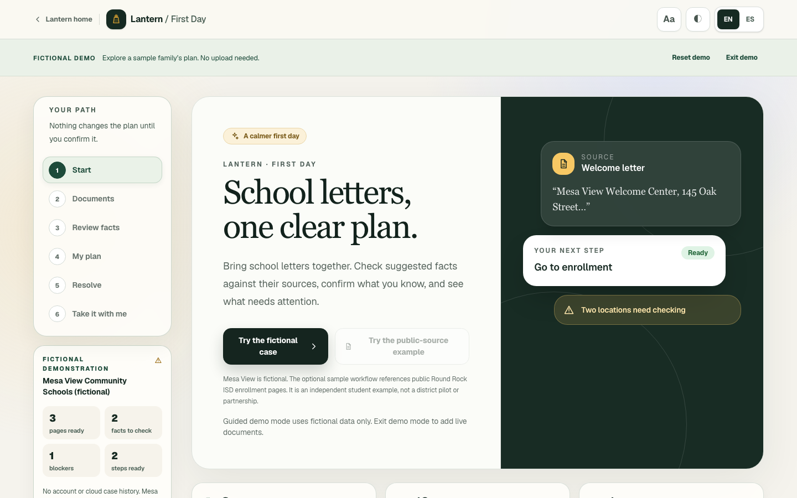
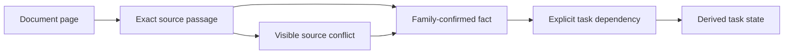

# Lantern: First Day

School enrollment instructions often arrive across several letters, reminders, and office notes. Lantern: First Day brings them into one case, shows each proposed fact beside its original words, asks the family to confirm what it knows, and turns the confirmed information into a source-linked plan. When pages disagree, Lantern keeps the conflict visible and prepares a question for the school instead of guessing. The interface and portable plan support English and Spanish.

**[Open the public app](https://lantern-first-day.vercel.app/)** · **[Try the fictional demo](https://lantern-first-day.vercel.app/first-day?demo=1)**



The demo uses fictional Mesa View Community Schools pages. It starts at Step 1, requires no account or upload, and makes no AI provider request. A separate [presenter view](https://lantern-first-day.vercel.app/first-day?demo=1&present=1) has timed story beats and recording cues.

## How the plan is made



AI may propose text, facts, and exact supporting quotes. Schemas and quote checks validate those proposals against the page. The family confirms, corrects, or marks facts unclear. Student-authored dependency rules and deterministic code decide whether each task is ready, waiting, needs review, needs clarification, or done. [Decision Trace](docs/submission/decision-trace-code-tour.md) shows the chain behind a plan state.

## Routes

| Route | Purpose |
| --- | --- |
| `/` | Landing page and product preview |
| `/first-day` | First Day workspace, including optional live page reading |
| `/first-day?demo=1` | Clean fictional judge demo |
| `/first-day?demo=1&present=1` | Presenter and recording cues |
| `/first-day/how-it-works` | Technical explanation and evaluation limits |
| `/explain` | General letter explanation tool |
| `/about` | Project background and independent public-source example |
| `/contact` | Feedback and pilot inquiries |
| `/privacy` | Data handling and provider boundaries |

Unknown paths use a branded 404 page. The server also provides validated API routes for page extraction, letter explanation, grounded follow-up, field translation, optional speech, optional local help, and capability health checks.

## Run locally

Use Node.js 20 or newer and npm.

```bash
npm install
cp .env.local.example .env.local
npm run dev
```

Open <http://localhost:3000>. The fictional demo works with empty provider keys. Live document reading and letter explanation require `GROQ_API_KEY`; optional server speech uses `ELEVENLABS_API_KEY`, and optional local-help search uses `PERPLEXITY_API_KEY`. Never commit `.env.local` or real family documents.

## Checks and evaluation

```bash
npm run lint
npm test
npm run build
npm run test:e2e
npm run evaluate:first-day
npm run evaluate:usability
```

The First Day evaluation replays versioned synthetic packets without making provider calls and writes [the report](evaluation/first-day/report.md). Its results measure this test set, not accuracy on real family records. The [usability protocol](evaluation/usability/protocol.md) is prepared for consenting adults using fictional documents; [its report](evaluation/usability/report.md) remains marked **Not started** until sessions occur. GitHub Actions runs lint, unit tests, the deterministic evaluation, build, browser tests, and Lighthouse on each push.

## Privacy and scope

The app does not intentionally store uploaded images or case history in a database. Live images are sent to configured providers only after submission; documents, extracted text, facts, tasks, and event history otherwise stay in page memory. Only language, large-text, and contrast preferences may persist locally. The public-source Round Rock ISD example uses public enrollment pages and is an independent student example, not a district pilot, partnership, or endorsement. See [Privacy](app/privacy/page.tsx) and the [backend code tour](docs/submission/backend-code-tour.md) for the detailed boundary.

## AI use disclosure

OpenAI Codex assisted with planning, code and test drafting, debugging, source review, browser verification, and documentation. Isaac reviewed and revised work before inclusion and owns the product goal, architecture decisions, evidence rules, evaluation interpretation, visual design, and release decisions. At runtime, Groq can assist with document reading, letter explanation, grounded responses, and field translation when configured; optional ElevenLabs speech and Perplexity local-help integrations are separate. AI does **not** confirm family facts, choose between conflicting sources, resolve tasks, or derive plan states. The fictional demo, planner, exports, and offline evaluation run without an AI request. See the complete [submission disclosure](docs/submission/ai-disclosure.md).

## Team

- Isaac Gong — Creator and project lead

## Project history

Lantern builds on the earlier public [TRANSLATEtheform](https://github.com/isaacgong0311-hash/TRANSLATEtheform) repository at commit `479ff86a30890c76a4ec0240406e66d9de4aa6ce` (imported here as `f4d4855`). This version adds the First Day planner, exact-evidence validation, deterministic task dependencies, conflict resolution, a bilingual portable plan, Decision Trace, and the synthetic evaluation harness. The general letter tool remains available at `/explain`.

## License

MIT. See [LICENSE](LICENSE).
